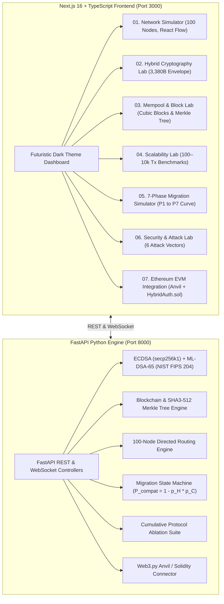

<p align="center">
  
</p>

<p align="center">
  
  
  
  
  
</p>

# QuantumResist: Interactive Hybrid Blockchain Research Simulator

> **Research Paper**: *A Secure and Scalable Hybrid Classical–Post-Quantum Cryptographic Framework for Quantum-Resilient Blockchain Systems*  
> **Author**: Md. Tanvir Hasan  
> **Affiliation**: Department of Computer Science Engineering, Daffodil International University, Savar, Dhaka 1216, Bangladesh  
> **ORCID**: [0009-0008-9130-3360](https://orcid.org/0009-0008-9130-3360)

---

## 🌟 Overview

**QuantumResist** is an interactive, research-grade simulation and visualization platform built to translate the cryptographic innovations, empirical benchmarks, and architectural models of Md. Tanvir Hasan's research into an accessible, high-impact scientific tool.

Instead of a generic blockchain explorer, QuantumResist provides a **dual-mode scientific laboratory**:
1. **Reference Results Mode (Read-Only)**: Ground-truth empirical results published in Section 4 of the paper (1,000-run cryptographic microbenchmarks, 10,000-transaction workloads, 7-phase migration compatibility, cumulative protocol ablation, and local Anvil EVM contract gas telemetry).
2. **Live Simulation Lab Mode (Interactive)**: Dynamically adjust network composition ratios, run live transaction batches, test signature bit-tampering, execute adversarial attack scenarios, and evaluate custom protocol ablation controls.

---

## 🏛️ Platform Architecture



---

## 🔬 The 7 Interactive Simulation Modules

| # | Module | Core Functionality | Visual Reference |
|---|--------|-------------------|------------------|
| **01** | **Blockchain Network Simulator** | 100-node network topology (Classical, Hybrid, PQC). Simulates directed packet routing and demonstrates asymmetric rejection ($H \to C$). Toggle between Real-time and Simulation modes. | React Flow dark mesh canvas |
| **02** | **Hybrid Cryptography Simulator** | Algorithm 1 & 2 keygen and signing. Interactive byte envelope visualizer (1B version, ~70B ECDSA DER, 3,309B ML-DSA-65 = 3,380B total). Strict AND verification and bit-tampering sandbox. | Packet breakdown diagram |
| **03** | **Transaction & Block Simulator** | Mempool ingestion pipeline, 3D gradient block cubes, incoming velocity metrics, and interactive SHA3-512 binary Merkle Tree generator. | Mempool.space dark mode |
| **04** | **Performance & Scalability Lab** | Workload evaluations (100, 500, 1k, 5k, 10k tx). Peak 1,054 TPS (1k tx) and 777.87 TPS at 10k. Analytical serialization bandwidth (27.04 Mbps) and 3.38 GB ledger projections. | Comparative scaling charts |
| **05** | **Seven-Phase Migration Simulator** | P1 to P7 lifecycle progression. Visualizes the 75.4% compatibility parity trough ($P_{\text{compat}} = 1 - p_H \cdot p_C$) and PQC-only recovery (4,107.50 TPS). | Roadmap & live trial curve |
| **06** | **Security & Attack Lab** | Live execution of Replay, Forgery, MITM, Duplicate, Key-Misbinding attacks. Interactive cumulative protocol ablation matrix (Table 11) and formal reduction theorems. | Terminal telemetry & matrix |
| **07** | **Ethereum EVM Integration** | Anvil local testnet (Chain ID 31337) deployment of `HybridAuth.sol`. 240,028 deployment gas, 70,442 accepted tx gas, and 5 functional test scenarios. | Gas meters & contract viewer |

---

## ⚡ Quick Start Guide

### Prerequisites
- **Node.js** v20+ & **npm**
- **Python** 3.10+ (Python 3.14 recommended)

### 1. Launch All Services (One-Click)
In PowerShell:
```powershell
.\start_all.ps1
```

### 2. Manual Startup

#### Backend (FastAPI on Port 8000)
```powershell
cd backend
.\.venv\Scripts\Activate.ps1
python -m uvicorn app.main:app --host 0.0.0.0 --port 8000 --reload
```
API Documentation will be available at: `http://localhost:8000/docs`

#### Frontend (Next.js on Port 3000)
```powershell
cd frontend
npm run dev
```
Interactive Platform will be live at: `http://localhost:3000`

---

## ⚖️ Scientific Integrity Callouts

1. **Simulation vs Production Consensus**: The 100-node network simulator models software-layer transaction creation, signature parsing, duplicate rejection, and local packet routing. It does not model live distributed Byzantine consensus, peer-to-peer gossip gossip fanout, or validator coordination.
2. **EVM Contract Policy Boundary**: The `HybridAuth.sol` contract enforces application nonces, transaction uniqueness, and caller-supplied Boolean outcomes. Cryptographic ML-DSA-65 verification is executed off-chain in the Python research engine.

